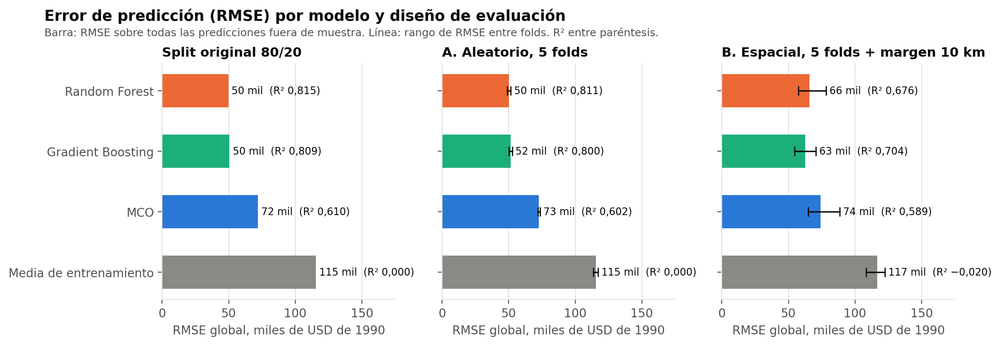
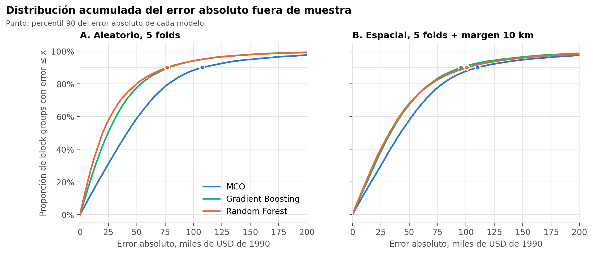
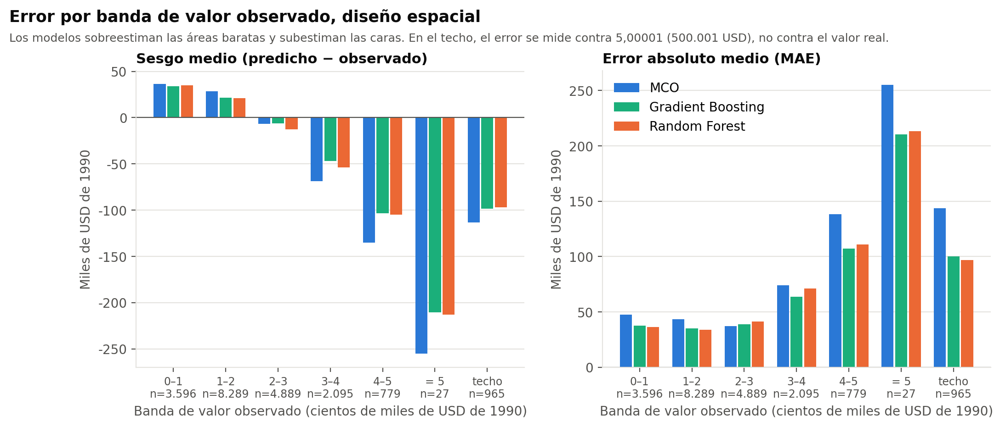
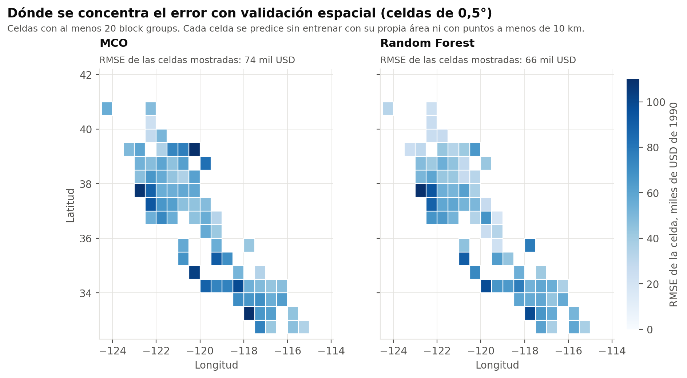

# Valor de la vivienda en California: el diseño de evaluación cambia el error y el modelo con menor RMSE

**Andrés Gualdrón · David Bonilla · Luisa Perdomo**

- **Pregunta.** ¿Cuánto mejora la predicción del valor mediano de la vivienda con modelos no lineales y qué desempeño conservan cuando se evita entrenar con áreas cercanas a las evaluadas?
- **Hallazgo.** Frente a MCO, la reducción del RMSE pasa del 31 % al 11 % en Random Forest y del 29 % al 15 % en Gradient Boosting al cambiar de una validación aleatoria a una espacial con margen de 10 km. El modelo con menor RMSE observado cambia de Random Forest a Gradient Boosting.
- **Límite de uso.** Son medianas por área censal (*block group*) de California en 1990, con el objetivo limitado en 500.001 USD. No sirven para valorar viviendas concretas ni para estimar precios actuales.



## Resultados

| | MCO | Random Forest | Gradient Boosting |
|---|---|---|---|
| **A. Validación aleatoria, 5 folds**: RMSE | 72.768 USD | **50.201 USD** | 51.605 USD |
| R² | 0,602 | **0,811** | 0,800 |
| Reducción del RMSE frente a MCO | — | 31,0 % | 29,1 % |
| **B. Validación espacial, 5 folds, celdas de 0,5° y margen de 10 km**: RMSE | 73.964 USD | 65.642 USD | **62.729 USD** |
| R² | 0,589 | 0,676 | **0,704** |
| Reducción del RMSE frente a MCO | — | 11,3 % | 15,2 % |

*USD de 1990. RMSE y R² calculados sobre las 20.640 predicciones fuera de muestra de cada diseño, no como promedio de folds. Fuente: `outputs/metricas.csv`.*

### Hallazgos observados

1. **Con validación aleatoria**, Random Forest y Gradient Boosting reducen el RMSE en torno al 30 % frente a MCO.
2. **Con validación espacial**, la reducción baja al 11 % (Random Forest) y al 15 % (Gradient Boosting). Entre ambos diseños, el RMSE de Random Forest sube un 31 %, el de Gradient Boosting un 22 % y el de MCO un 1,6 %.
3. **El modelo con menor RMSE observado cambia** de Random Forest (A) a Gradient Boosting (B), bajo estas especificaciones fijas. No es una superioridad general ni una diferencia probada estadísticamente.
4. **La dispersión entre folds crece en B.** El RMSE de Random Forest va de 0,488 a 0,516 entre folds en A, y de 0,575 a 0,783 en B. En el fold espacial 3, el RMSE de Random Forest (0,782520) supera al de MCO (0,757978). Ese fold contiene la mayor parte de las áreas que delimitamos como Bahía de San Francisco, junto con áreas de otras regiones; la cifra corresponde al fold completo.
5. **Ningún modelo corrige el sesgo en los extremos**: todos sobreestiman las áreas de menor valor y subestiman las de mayor valor (figura 3).

**Hipótesis compatible, no demostrada.** Las coordenadas y el ingreso concentran la mayor parte de la información predictiva de los árboles (`outputs/importancias.csv`). Una explicación compatible con los resultados es que parte de su ventaja proviene de información local que el diseño espacial retira del entrenamiento. El diseño no identifica ese mecanismo: entre A y B cambian a la vez la cercanía geográfica, la composición y el tamaño del entrenamiento (de 16.512 filas a entre 13.144 y 15.568).

### Distribución del error



| Error absoluto | Mediana | Percentil 90 | Áreas con error < 50.000 USD |
|---|---|---|---|
| Random Forest, aleatorio | 19.959 USD | 76.741 USD | 80,1 % |
| Random Forest, espacial | 32.489 USD | 100.731 USD | 68,0 % |
| Gradient Boosting, espacial | 33.529 USD | 95.612 USD | 67,4 % |
| MCO, espacial | 42.250 USD | 110.298 USD | 57,8 % |

*Fuente: `outputs/distribucion_errores.csv`. RMSE, MAE y mediana del error absoluto son métricas distintas: en B, Gradient Boosting tiene RMSE 62.728,61 USD, MAE 45.239,03 USD y mediana 33.529 USD.*

### Dónde se concentra el error

| Por banda de valor (figura 3) | Por localización (figura 2) |
|---|---|
|  |  |

- **Por valor** (`outputs/errores_por_segmento.csv`). En B, todos sobreestiman la banda por debajo de 100.000 USD (unos +35.000 USD) y subestiman la de 400.000 a 500.000 USD (entre −103.000 y −135.000 USD).
- **En el techo.** En las 965 áreas con valor 5,00001, el RMSE espacial es 1,29 (Gradient Boosting), 1,36 (Random Forest) y 1,69 (MCO), frente a 0,58, 0,60 y 0,66 en el resto. Se mide contra 500.001 USD, no contra el valor real, que es desconocido: no se puede saber cuánto se equivocan los modelos en las áreas más caras.
- **Por localización** (`outputs/errores_por_celda.csv`). Los RMSE de celda más altos en B aparecen en celdas costeras de valor alto (Área de la Bahía, Santa Bárbara, San Luis Obispo, costa norte de San Diego). En las 73 celdas con al menos 20 áreas, Random Forest tiene menor RMSE que MCO en el 71 % y Gradient Boosting en el 77 %.

### Asociaciones, no efectos causales

Con MCO estimado en el entrenamiento del split original, 10.000 USD más de ingreso mediano se asocian con unos 44.000 USD más de valor mediano, manteniendo constantes las demás variables incluidas (`outputs/coeficientes_mco.csv`). Los errores estándar de esa tabla son HC3: corrigen la heterocedasticidad, pero no la dependencia espacial entre áreas, así que sus intervalos y p-valores no son inferencia ajustada espacialmente. Los signos opuestos de habitaciones y dormitorios reflejan su colinealidad. Las importancias de los árboles miden información predictiva, no efectos.

## Datos y métodos

- **Datos:** California Housing (Pace y Barry, 1997), derivada del censo de EE. UU. de 1990 y distribuida con scikit-learn: 20.640 *block groups*, sin faltantes ni duplicados completos. Entrada: `data/california_housing.csv` (SHA-256 fijado en `config.json`).
- **Objetivo:** `MedHouseVal`, valor **mediano** de la vivienda del área, en cientos de miles de USD de 1990, limitado en 5,00001 (965 áreas, 4,7 %). **Predictores (8):** ingreso y edad de la vivienda (medianas); habitaciones, dormitorios y personas por hogar (promedios); población (total); latitud y longitud.
- **Modelos, sin ajuste de hiperparámetros:** media del entrenamiento (referencia); MCO con los ocho predictores; Random Forest (300 árboles, profundidad libre); Gradient Boosting (300 árboles, tasa 0,05, profundidad 3). Semilla 123.
- **Evaluación:** los cuatro modelos se entrenan y evalúan sobre las mismas filas en tres diseños: el split original 80/20 (reproducción), A (5 folds aleatorios) y B (celdas de 0,5° completas en un fold con `GroupKFold`, excluyendo del entrenamiento todo punto a menos de 10 km haversine de algún punto evaluado).
- **Corrección del trabajo original:** el notebook evaluaba MCO dentro de muestra (RMSE 0,7241) y los árboles en el 20 % de prueba. Evaluado sobre las mismas filas de prueba, MCO da 0,7197. Detalle y diferencias residuales en la nota metodológica.

Protocolo fijado antes de ejecutar: [`docs/PROTOCOLO.md`](docs/PROTOCOLO.md). Definiciones, particiones, reproducción y comprobaciones: [`docs/NOTA_METODOLOGICA.md`](docs/NOTA_METODOLOGICA.md). Material para CV y entrevista: [`docs/CV_Y_ENTREVISTA.md`](docs/CV_Y_ENTREVISTA.md).

## Límites

- Áreas censales de 1990, no viviendas ni transacciones; no extrapolar a precios actuales ni a valoraciones individuales.
- El techo del objetivo impide medir el error real en el segmento más caro.
- B evalúa áreas omitidas **dentro de California en 1990** con 10 km de separación; no demuestra transferencia a otro estado ni a otra época.
- La comparación entre A y B es descriptiva: no aísla la dependencia espacial del cambio de composición y tamaño del entrenamiento.
- Hiperparámetros fijos; otra configuración podría cambiar el orden entre Random Forest y Gradient Boosting.

## Reproducción

```bash
pip install -r requirements.txt
python3 run.py
```

Ejecuta todo en unos 3 minutos y escribe `outputs/verificaciones.csv` con cada comprobación en estado PASS, FAIL o NO DISPONIBLE (N/A). Las comprobaciones NO DISPONIBLE corresponden a archivos opcionales del trabajo original que no viajan en el paquete público y no cuentan como superadas. Cualquier FAIL detiene la ejecución con código 1. Si el fallo ocurre antes de las particiones (huella del CSV, estructura de los datos o un original presente con otra huella), la ejecución se detiene antes de escribir `verificaciones.csv`; el motivo queda en `outputs/ejecucion.log` y en la salida de la terminal.

Pruebas de componentes:

```bash
python3 -m unittest discover -s tests -t . -v
```

## Créditos

Trabajo original: **Andrés Gualdrón, David Bonilla y Luisa Perdomo**, Taller de programación aplicada en Python. David Bonilla participó en el marco teórico, la planificación, el código, el análisis y la redacción. El notebook original se conserva de forma privada y no se incluye en este paquete; el proyecto se ejecuta solo con el CSV incluido.

Esta versión reorganiza el trabajo como caso de portafolio: corrige la comparación entre modelos, añade validación aleatoria y espacial con margen, analiza la distribución del error y documenta límites y comprobaciones.

Referencias: Pace, R. K. y Barry, R. (1997). Sparse spatial autoregressions. *Statistics & Probability Letters*, 33(3), 291–297. Rosen, S. (1974). Hedonic prices and implicit markets. *Journal of Political Economy*, 82(1), 34–55. [Documentación del conjunto de datos en scikit-learn](https://scikit-learn.org/stable/datasets/real_world.html#california-housing-dataset). [Errores HC3 en statsmodels](https://www.statsmodels.org/stable/generated/statsmodels.regression.linear_model.OLSResults.HC3_se.html).
